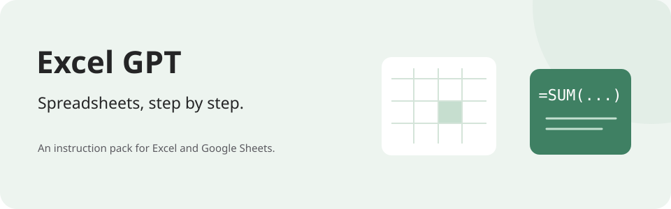

# Excel GPT

**Spreadsheets, explained step by step.**



An open-source instruction pack for an Excel and Google Sheets assistant.
It helps teammates learn the task, with formulas, precise steps, and checks for the result.

[**Start with the instructions →**](instruction.txt) · [Customize the pack](#make-it-yours)

## Clear steps for everyday spreadsheet work

The pack asks for the platform, source data, destination, and expected result before giving
instructions. It uses plain language for non-technical teammates.
Developer Mode gives shorter expert answers when the user requests it.

It provides guidance. It does not promise direct file access or hidden spreadsheet edits.

## Set up the pack

1. Use [`instruction.txt`](instruction.txt) as the assistant's core instructions.
2. Add the `excel_*.txt` files and your reviewed `custom/*.txt` files as supporting knowledge.
3. Replace the customization placeholders with your team's approved information.
4. Test with an anonymous sample before sharing the assistant with your team.

The core instructions give `custom/*.txt` rules priority over the base guidance.
Keep those files together when sharing a customized pack.

## Make it yours

| File | Customize |
| --- | --- |
| [`custom_identity_template.txt`](custom/custom_identity_template.txt) | Team, tools, locale, and support contacts. |
| [`custom_data_sources_template.txt`](custom/custom_data_sources_template.txt) | Approved datasets, tabs, keys, owners, and refresh notes. |
| [`custom_style_conventions.txt`](custom/custom_style_conventions.txt) | Vocabulary, tab names, formatting, and spreadsheet conventions. |
| [`custom_operating_overrides.txt`](custom/custom_operating_overrides.txt) | Platform limits, approval steps, and response rules. |
| [`custom_solution_templates.txt`](custom/custom_solution_templates.txt) | Reviewed formulas, automation patterns, and handoff prompts. |

Use placeholders in examples. Include only information the assistant's audience is allowed
to see. Review formula and automation templates before distributing them.

## What is in the pack

| File | Purpose |
| --- | --- |
| [`instruction.txt`](instruction.txt) | Core instructions, workflow, and Developer Mode. |
| [`excel_overview_readme.txt`](excel_overview_readme.txt) | Pack overview. |
| [`excel_response_playbook.txt`](excel_response_playbook.txt) | Questions to ask and steps to provide. |
| [`excel_communication_scope.txt`](excel_communication_scope.txt) | Voice, audience, and topic boundaries. |
| [`excel_quality_safety.txt`](excel_quality_safety.txt) | Data checks, backups, and common mistakes. |
| [`excel_reference_guides.txt`](excel_reference_guides.txt) | Spreadsheet references. |

Clone or download the files. There is no application build step.

```sh
git clone https://github.com/nickdrezza/excel-gpt.git
```

## License

This project is licensed under [GNU AGPLv3 only](LICENSE) (`AGPL-3.0-only`).
See [NOTICE](NOTICE) for copyright information.

You can use, change, and sell copies under the license terms.
If you distribute covered code, provide its source under the same license.
If you change the project and let users access it over a network,
offer those users the source of your version.
